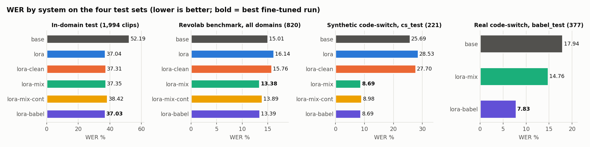
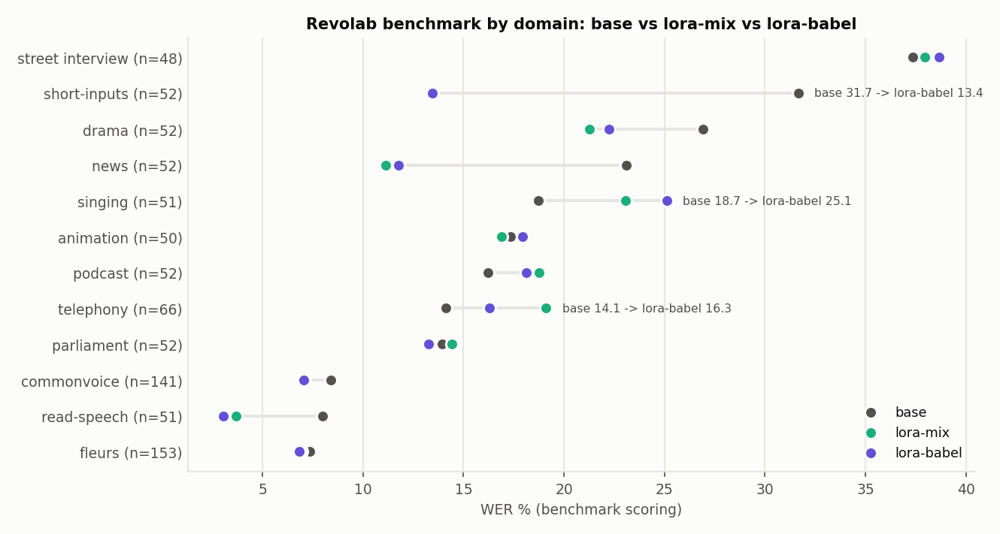
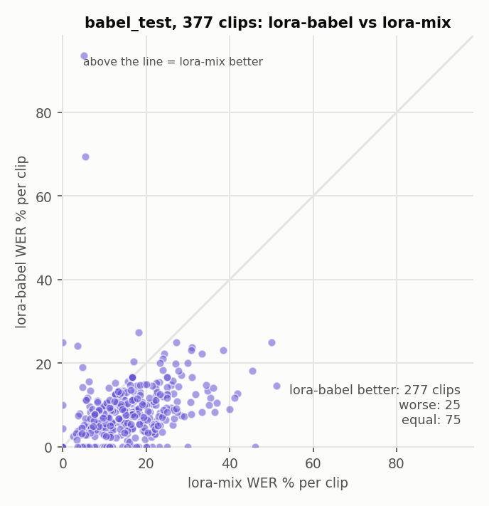
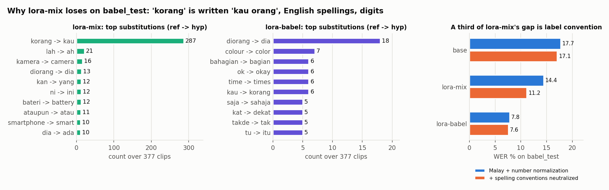
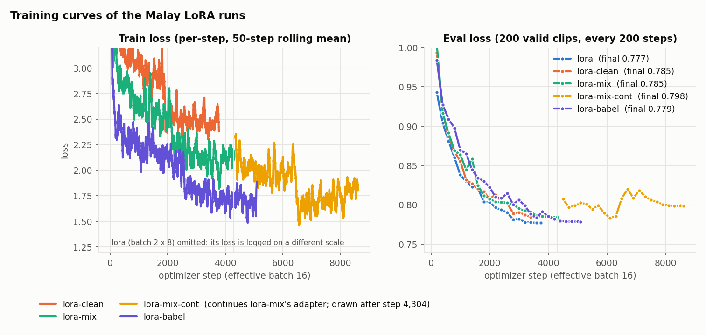
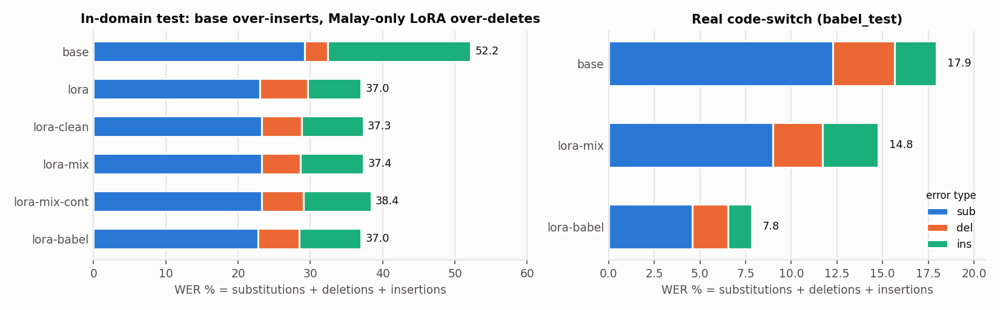
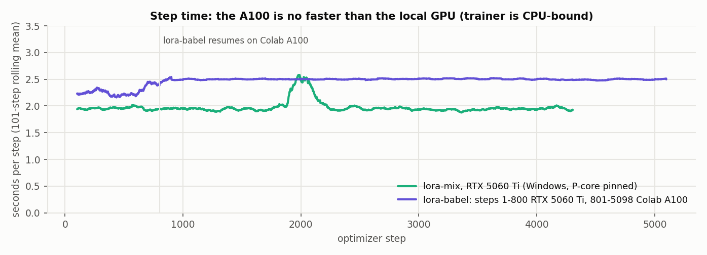

# Malay results: Qwen3-ASR-1.7B LoRA on Malay and Malay-English code-switch (updated 2026-10-13)

**Bottom line.** A Malay-only LoRA wins in-domain but loses to the base model out of domain (truncated labels +
English forgetting). Mixing in code-switched and English speech fixes most of it (`lora-mix`), and adding 12 h of
real conversational Malay (`lora-babel`, BabelSpeech) halves the error on real code-switched speech from an unseen
speaker (WER 14.8 -> **7.8**) while leaving every other test unchanged. **`lora-1.7b-malay50h-babel` is the best
system.** Part of its gain on BabelSpeech is label-convention matching (see "How much of the babel gain is real").

The short version and the repository guide are in the top-level [README](../README.md).

## Datasets: what they are, where they come from, what domain, why

| Dataset | Source and licence | Size used | Domain and labels | Why it is in the mix |
|---|---|---|---|---|
| **Malay base** | `mesolitica/malaya-speech-malay-stt` (Hugging Face; whole set 1.63 M clips / ~2,600 h / 53 GB parquet) | 50 h random train subset (fixed seed), 1,994-clip test | Web-crawled Malay speech (YouTube, podcasts, read speech), no domain tags. Labels are semi-supervised Google Speech-to-Text, lowercase, no punctuation; ~6% truncated | The only large public Malay ASR corpus; 50 h is enough to move the model and cheap enough (2 h per run on a 16 GB GPU) to iterate |
| **Synth-Manglish** | `emhaihsan/Synth-Manglish` (Hugging Face) | ~7 h train, 221-clip `cs_test` | TTS of Malay-English code-switched sentences, a few fixed voices; everyday-conversation style, not real speakers | Cheapest code-switch signal available; added after the Malay-only LoRA started rewriting English as Malay. Its test split is in-distribution and optimistic |
| **cs_pilot** | one Malaysian podcast episode, cut locally (`D:/cs_mining/cs_pilot`, not public) | 200 clips, train only | Real podcast code-switch; labels machine-made (Qwen3-ASR + Whisper merged by an LLM), unchecked | A few real code-switch examples; no result is reported on it because the labels are not verified |
| **FLEURS en_us** | `google/fleurs`, config `en_us` (Hugging Face, CC-BY) | 5 h train, tagged `language English` | Read Wikipedia sentences in English | Keeps the English language token alive so English words inside Malay speech are not forced into Malay |
| **BabelSpeech** | `BabelSpeech/50hours_Malay_Real-world_Colloquial_Conversation_and_Monologue_Speech_Dataset` (Hugging Face, Apache-2.0; the download holds 34.9 h / 10,319 clips from 10 speakers, spk005 alone 23 h) | 12 h train (per-speaker cap 10 h), spk001 (1.8 h, 377 clips) held out as `babel_test` | YouTube colloquial Malay with natural English code-switching; README domains: technology, entertainment, travel, education, daily life. The dominant speaker reviews phones and gadgets. Human-checked labels (>98% claimed), SNR and DNSMOS per clip | The only human-labelled real conversational code-switch data found; whole-speaker hold-out gives the one real code-switch test in this report |
| **Revolab benchmark** (test only) | `Revolab/ASR-Benchmark-Public` (Hugging Face, gated) + normalizer from `revolab-sdn-bhd/revolab-asr-benchmark` | 820 clips | 12 domains: news, parliament, read speech, commonvoice, fleurs, drama, animation, podcast, street interview, telephony, singing, short inputs; human labels | Out-of-domain check for every run; the set that exposed English forgetting (telephony 14 -> 33) |

Download: `huggingface-cli download <repo> --repo-type dataset` into `D:/hf_datasets/` (Revolab needs `huggingface-cli login`);
`data_prep/build_malay_dataset.py`, `build_malay_mix.py`, `build_malay_babel.py` turn them into the prepared format.
All extra transcripts are lowercased and stripped of punctuation to match the Malay labels.

## Systems

| System | Train data | Hours / clips | Steps | Trained on |
|---|---|---|---|---|
| base | — | — | — | — |
| lora | random 50h of `mesolitica/malaya-speech-malay-stt` | 50.0h / 29,966 | 3,746 | RTX 5060 Ti |
| lora-clean | same, minus truncated-label clips (VAD), topped up to 50h | 50.0h / 30,225 | 3,778 | RTX 5060 Ti |
| lora-mix | lora-clean + Synth-Manglish + cs_pilot (code-switch) + 5h FLEURS en_us (`language English`) | 63.0h / 34,425 | 4,304 | RTX 5060 Ti |
| lora-mix-cont | lora-mix trained 2 more epochs from its adapter (`--init_adapter`, lr 5e-5) | 63.0h | 4,304 | RTX 5060 Ti |
| **lora-babel** | lora-mix data + BabelSpeech Malay (12.0h, 9 speakers, spk005 capped at 10h; spk001 held out) | 83.0h / 40,771 | 5,098 | 800 steps RTX 5060 Ti, rest Colab A100 |

cs_pilot (200 train clips) comes from one podcast episode with machine-generated labels (Qwen3-ASR + Whisper merged
by an LLM, no human check), so it is used for training only and **no result is reported on it**.

All LoRA runs: r=16, alpha=32 on the LLM's attention + MLP (17.4M trainable, 0.85%), 2 epochs, lr 1e-4 cosine,
effective batch 16 (lora: 2 x 8; others: 4 x 4), bf16, gradient checkpointing, seed 42.
Train wall time: lora 4.1h, lora-clean 1.7h, lora-mix 2.3h on the RTX 5060 Ti 16GB (Windows, trainer pinned to
P-cores, see below); lora-babel 0.3h local + 3.0h on a Colab A100 (see "Colab").

## Test sets

| Set | Clips | What it is | Caveat |
|---|---|---|---|
| in-domain test | 1,994 | held-out `malaya-speech-malay-stt` clips | semi-supervised labels (Google STT), ~6% truncated |
| Revolab/ASR-Benchmark-Public | 820 | 12 domains, human labels | out of domain for every run |
| cs_test | 221 | held-out Synth-Manglish TTS clips | same voices/source as lora-mix training data: optimistic |
| babel_test | 377 (1.8h) | BabelSpeech speaker spk001, real colloquial code-switch, human labels | one speaker; same corpus/label conventions as lora-babel's extra train data |

Scoring: `score_malay.py` (Revolab's MalayTextNormalizer + Malay number spelling); Revolab numbers use the
benchmark's own scoring (best of `text`/`normalized_text` per row).

## Results

### In-domain test (1,994 clips)

"Clean" = the 1,860 clips whose label is not truncated.

| System | WER | Sub | Del | Ins | WER clean clips |
|---|---|---|---|---|---|
| base | 52.10 | 29.21 | 3.03 | 19.85 | 46.76 |
| lora | **37.07** | 23.04 | 6.60 | 7.42 | 34.92 |
| lora-clean | 37.32 | 23.25 | 5.59 | 8.49 | 34.69 |
| lora-mix | 37.35 | 23.29 | 5.35 | 8.71 | **34.63** |
| lora-mix-cont | 38.42 | | | | 35.34 |
| lora-babel | **37.03** | 22.79 | 5.70 | 8.54 | n/a |

### Revolab/ASR-Benchmark-Public (820 clips, 12 domains, out of domain)

| Domain | n | base | lora | lora-clean | lora-mix | lora-babel |
|---|---|---|---|---|---|---|
| **All** | 820 | 15.01 | 16.14 | 15.76 | **13.38** | 13.39 |
| news | 52 | 23.11 | 12.97 | 13.39 | **11.13** | 11.77 |
| short-inputs | 52 | 31.67 | 17.65 | 18.49 | **13.45** | **13.45** |
| drama | 52 | 26.91 | 26.80 | 26.14 | **21.26** | 22.26 |
| read-speech | 51 | 7.98 | 3.68 | 4.60 | 3.68 | **3.07** |
| commonvoice | 141 | 8.40 | 7.36 | 7.45 | 7.08 | **7.05** |
| fleurs | 153 | 7.34 | 7.38 | 7.47 | 6.93 | **6.83** |
| animation | 50 | 17.35 | 20.81 | 18.70 | **16.89** | 17.95 |
| parliament | 52 | 13.93 | 15.38 | 15.48 | 14.43 | **13.27** |
| street interview | 48 | **37.35** | 45.38 | 42.27 | 37.95 | 38.65 |
| podcast | 52 | **16.21** | 22.76 | 21.73 | 18.78 | 18.12 |
| singing | 51 | **18.72** | 36.76 | 29.45 | 23.06 | 25.11 |
| telephony | 66 | **14.14** | 33.47 | 38.37 | 19.11 | 16.29 |

lora-mix-cont: All 13.89. Domains have ~50 clips, so differences of 1-2 points between lora-mix and lora-babel are
within noise; the telephony gain (19.1 -> 16.3) is the one that looks real and is plausible (closest domain to
conversational speech).

### Synthetic code-switch test (cs_test)

221 held-out Synth-Manglish clips (the `malay_50h_babel` build; `results/malay/cs_test_summary.json`, basic
normalization). The earlier 203-clip version with Malay normalization gave lora-mix 7.42.

| System | WER | CER |
|---|---|---|
| base | 25.69 | 9.77 |
| lora | 28.53 | 13.09 |
| lora-clean | 27.70 | 12.25 |
| lora-mix | 8.69 | 4.01 |
| lora-mix-cont | 8.98 | 4.19 |
| lora-babel | 8.69 | **3.95** |

The Malay-only runs are *worse* than base here (English forgetting); the code-switch/English mix fixes it. TTS from
the same source and voices as the training data, so in-distribution and optimistic; not evidence about real
code-switched speech. babel_test below is.

### Real code-switch test (babel_test: BabelSpeech speaker spk001, 377 clips, 20,175 words)

| System | WER | CER | Sub | Del | Ins | clips better / worse than lora-mix |
|---|---|---|---|---|---|---|
| base | 17.94 | 8.69 | 12.29 | 3.37 | 2.29 | |
| lora-mix | 14.76 | 6.96 | 8.98 | 2.74 | 3.05 | |
| lora-babel | **7.83** | **4.23** | 4.57 | 1.97 | 1.28 | 277 / 25 (75 equal) |

lora-mix never saw BabelSpeech, so its 17.9 -> 14.8 is a true out-of-domain gain on real code-switched speech.
lora-babel saw 12h of the same corpus from other speakers.

#### How much of the babel gain is real recognition?

lora-mix's single biggest error on this set is a spelling convention: it writes "kau orang" where BabelSpeech labels
write "korang" (287 clips), and similarly camera/kamera, battery/bateri, screen/skrin, "dia orang"/diorang, and
digits where the labels spell numbers out. lora-babel learned these conventions from the other BabelSpeech speakers.
Re-scoring with those spelling variants and number formats neutralised on both sides:

| System | WER (num-normalised) | WER with conventions neutralised |
|---|---|---|
| base | 17.71 | 17.06 |
| lora-mix | 14.41 | 11.16 |
| lora-babel | 7.80 | **7.57** |

So roughly a third of the lora-mix -> lora-babel gap is label convention; the remaining 3.6 points (32% relative)
is recognition. Remaining lora-babel errors are mostly discourse particles (dropped "kan", "lah", "dia"; inserted
"aku", "lah", "and") and diorang/dia, where labels themselves are inconsistent.

**Caveat:** one speaker, one recording setup. Treat 7.8 as an in-corpus number. The robust claims are: adding real
conversational data did not hurt any other test, and it helped telephony.

### Continued training (lora-mix-cont)

Eval loss had looked flat at the end of lora-mix only because the cosine LR had reached 0, so lora-mix was trained
2 more epochs from its final adapter (`--init_adapter`, fresh warmup + cosine, lr 5e-5, 4,304 steps).
Eval loss bottomed at 0.783 (step 1,800) and then rose to ~0.80 while train loss kept falling: overfitting on
epochs 3-4 of the same data. Worse everywhere (test 38.42, Revolab 13.89, cs_test 7.48). More epochs on the same
data do not help; new data does (lora-babel).

## Analysis

1. **In-domain gain is real and stable** (~37 WER vs 52) and does not depend on the data variant. Remaining errors
   are mostly short function words in fast conversational speech (di/dia, nak/anak, korang/orang, dah/dan).
2. **Truncated labels -> deletions.** The corpus is semi-supervised; Silero VAD finds ~6% of clips whose transcript is
   far too short for the speech and ~1% with no speech. Training on them taught the model to drop words. Removing
   them (lora-clean) lowers deletions, but the overall gain is small because the test labels are equally noisy.

3. **English / code-switch forgetting was the main out-of-domain problem.** Malay-only LoRAs map English speech onto
   Malay words ("that's all" -> "datang"), wrecking telephony (14 -> 33-38). Adding 7.3h code-switch + 5h English
   (lora-mix) fixes most of it; adding 12h real conversational Malay (lora-babel) adds nothing on Revolab overall but
   halves the error on real conversational code-switch.
4. Numbers and punctuation move WER by < 2 points for every system, except on BabelSpeech where spelled-out numbers
   and spelling conventions matter (see above).
5. Base WER is 18 on BabelSpeech but 52 on the in-domain test: most of the in-domain number is label noise, not
   model quality. Compare systems on clean-labelled sets where possible.

## Training-infrastructure findings

Windows, RTX 5060 Ti 16GB, i5-14400F:
- The trainer is single-thread CPU-bound at small batch. Windows schedules the hidden background process on E-cores,
  halving speed; pinning to P-cores (`CPU_AFFINITY=0-11`) took throughput from 4.4 to ~8.7 samples/s (GPU 30% -> 92%).
- CUDA "sysmem fallback" lets the caching allocator silently spill past VRAM into shared system RAM; a per-process
  cap (`CUDA_MEM_FRACTION=0.8`) prevents it.
- Trainer restores the checkpoint's `train_batch_size` on resume, silently ignoring a new `--batch_size`;
  `train_qwen_asr.py` refuses such a resume.
- HF eval loss is a mean of per-batch means, so it shifts with eval batch size; compare runs by WER, not eval loss.

Colab (`notebooks/colab_train_malay_babel.ipynb`, A100 40GB):
- Resuming the Windows checkpoint failed twice before training started: Colab's torchao 0.10 breaks peft's LoRA
  injection (uninstall it), and torch>=2.6 refuses the checkpoint's `rng_state.pth` pickled under numpy 1.x
  (`train_qwen_asr.py` now allowlists the numpy globals).
- The A100 was **not faster than the RTX 5060 Ti**: 2.55 s/step vs 1.9-2.3 s/step, peak 8.75GB of 40GB used. The
  dataloader/collator is the bottleneck and Colab's CPU is weak. For new Colab runs use batch 16, grad_acc 1 and more
  workers; a resumed run must keep the checkpoint's batch size.
- Data must be copied from Drive to local disk first (memmap through the Drive FUSE mount is far too slow); the
  output dir is a symlink into Drive so checkpoints survive disconnects.

## Quantization of the best Malay model (lora-babel merged, HQQ, RTX 5060 Ti)

`eval_quant.py --adapter outputs/lora-1.7b-malay50h-babel/adapter` merges the adapter into the base and sweeps
weight-only HQQ on the LLM linears (audio encoder bf16). Basic normalization; babel_test = 377 clips unless noted,
in-domain = 300 random test clips. Inference time is for babel_test on the RTX 5060 Ti (transformers backend,
HQQ dequantizes on every matmul, so int8/int4 are 2-3x slower here; vLLM's FP8 path does not have this cost).

| Precision | babel_test WER | babel CER | in-domain WER (300) | GPU after load | Inference |
|---|---|---|---|---|---|
| bf16 | 8.62 | 4.37 | 36.22 | 3.80 GB | 344 s |
| HQQ int8, g64 | 8.65 | 4.36 | 35.90 | 2.66 GB | 916 s |
| RTN int6 (simulation, no memory saving) | 8.75 | 4.52 | – | 6.47 GB | 410 s |
| HQQ int4, g64 | 10.06 | 4.79 | 39.42 | 4.66 GB | 902 s |
| HQQ int3, g64 | 144.61 (60 clips) | 126.21 | – | 1.88 GB | 596 s* |
| HQQ int3, g16 | 73.85 (60 clips) | 59.77 | – | 4.28 GB | 478 s* |
| HQQ int2, g64 | 104.90 (60 clips) | 138.16 | – | 5.95 GB | 432 s* |

\* 60-clip subset. int8 is free (+0.03 / -0.3 WER), int4 costs 1.4-3.2 WER, 3-bit and 2-bit collapse without calibration (group 16 helps but stays unusable). For serving,
`deploy/` uses vLLM's weight-only FP8 (near-lossless, no dequantization cost). The int4 memory reading (4.66 GB) is
higher than int8's and was not investigated (HQQ 4-bit keeps extra fp32 state on this setup). Raw: `results/malay/quant_malay_*.json`.

## Serving the best model: vLLM FP8 in Docker, baseline, load test, bottleneck

`deploy/` serves the merged lora-babel checkpoint with vLLM 0.14 (`vllm/vllm-openai:v0.14.0` + qwen-asr) as an
OpenAI-compatible API, weight-only FP8 on the LLM linears. Everything below was measured on the Windows PC
(RTX 5060 Ti 16 GB, 150 W limit, Docker Desktop / WSL2); scripts `deploy/bench_offline.py`, `deploy/bench.py`,
`deploy/eval_api.py`; raw numbers in `results/malay/offline_bench.json`, `served_bench.json`,
`served_babel_test_*.json`.

### Quality through the server (babel_test, 377 clips)

| Path | basic WER | Malay-normalised WER | CER |
|---|---|---|---|
| transformers bf16, offline (`eval_quant.py`) | 8.62 | 7.81 | 4.37 |
| vLLM bf16, served | 8.56 | 7.77 | 4.68 |
| vLLM FP8, served | 8.85 | 8.02 | 4.78 |

FP8 costs about 0.25 WER against bf16 on the same server, on the order of run-to-run noise. **One trap found on
the way:** the first FP8 pass scored 20.0 WER. Two consecutive clips from one video send the decoder into a
repetition loop ("xiaomi xiaomi ...") in bf16 and FP8 alike; offline they are cut at `max_new_tokens=400`, but vLLM's
transcription endpoint ignores the generation config and decodes up to `max-model-len` (4,096), so each emitted
~1,200 words and the pair alone added 11 WER points to the set. Fix: send `max_completion_tokens=400` with every
request (now the default in the scripts, documented in `deploy/README.md`).

### Baseline (Part 2): transformers bf16, one clip at a time

| Clip length | n | avg RTF | p50 RTF | p95 RTF | p50 latency |
|---|---|---|---|---|---|
| 2-5 s | 16 | 0.407 | 0.366 | 0.622 | 1.50 s |
| 5-15 s | 16 | 0.357 | 0.343 | 0.461 | 2.90 s |
| 15-30 s | 16 | 0.400 | 0.395 | 0.499 | 10.47 s |

GPU 17% busy at 46 W: the per-token Python decode loop sets the speed, not the GPU. Batching 8 clips in the same
backend brings the aggregate RTF to 0.053 (377 clips, 6,480 s of audio, in 344 s).

### Served (Parts 3-4): vLLM FP8, 24 clips of 2-30 s, 256 requests per level

Single stream by clip length: 2-5 s p50 RTF 0.045 (0.18 s), 5-15 s 0.039 (0.33 s), 15-30 s 0.042 (1.09 s).

| Concurrent | avg RTF | p50 RTF | p95 RTF | p95 latency | throughput (x real time) | req/s | GPU util | VRAM | power |
|---|---|---|---|---|---|---|---|---|---|
| 1 | 0.043 | 0.041 | 0.069 | 1.37 s | 24 | 1.9 | 97% | 11.3 GB | 123 W |
| 4 | 0.047 | 0.045 | 0.077 | 1.47 s | 87 | 6.9 | 99% | 11.3 GB | 118 W |
| 16 | 0.055 | 0.052 | 0.089 | 1.71 s | 294 | 23.3 | 98% | 11.3 GB | 125 W |
| 32 | 0.066 | 0.062 | 0.107 | 2.02 s | 460 | 36.5 | 99% | 11.3 GB | 127 W |
| 64 | 0.088 | 0.084 | 0.145 | 2.55 s | 614 | 48.7 | 97% | 11.3 GB | 130 W |
| 96 | 0.114 | 0.109 | 0.191 | 3.18 s | 685 | 54.4 | 99% | 11.3 GB | 130 W |
| 128 | 0.157 | 0.133 | 0.286 | 3.36 s | 684 | 54.3 | 97% | 11.3 GB | 131 W |
| 256 | 0.224 | 0.155 | 0.610 | 3.82 s | 674 | 53.4 | 99% | 11.3 GB | 130 W |

Optimization journey: one-clip transformers loop RTF 0.39 (GPU 17%) -> batch 8 in transformers 0.053 -> HQQ int8
rejected for serving (2.7x slower from per-matmul dequantization) -> vLLM FP8 continuous batching 0.043 single
stream -> 128 concurrent requests at p95 RTF 0.29, 685x real time; p95 RTF passes 0.5 at 256.

### Bottleneck (Part 6)

GPU compute: SM utilization 97-99% from 2 streams on, 120-131 W of the 150 W limit (not power-capped), VRAM flat
at 11.3 GB of 16. Throughput saturates at ~685x real time from 96 streams; beyond `MAX_SEQS=96` active sequences the
extra requests queue in vLLM, which is what lifts p95 from 0.19 (96) to 0.61 (256). First knob to try: raise
`MAX_SEQS` with more KV cache (`GPU_MEM`) and `--kv-cache-dtype fp8`. Host-side: WSL2 disables pinned memory; a
native Linux host would be faster. Whole-file requests only; streaming (VAD + partials) was not load-tested on
this model.

## Next steps

1. A second held-out BabelSpeech speaker (spk009, 0.2h, costs nothing in training data) to get a multi-speaker real
   code-switch test; longer term, human-verified clips from a different source (e.g. the `D:/cs_mining` podcast
   pipeline once its labels are checked).
2. Add spelling-variant normalisation (korang/kau orang, kamera/camera, number spelling) to `score_malay.py` so
   systems are compared on recognition, and report both numbers.
3. Telephony and singing still trail base: narrowband / music augmentation or more such data.
4. Add data rather than epochs: more speakers and settings rather than more hours of spk005 (already 10 of the 12
   BabelSpeech hours).

## Reproduce

All figures: `python plot_malay.py` (reads `results/malay/`, writes `docs/figures/`).
See `scripts/run_malay.sh` (the full data -> train -> eval chain with the paths used here) and the Colab notebook
for training/evaluating without a local GPU. Per-clip predictions, scores and train logs for all systems are in
`results/malay/` (`test_*`, `revolab_*`, `cs_test_*`, `babel_test_*`, `train_log_*`, `train_summary_*`). The best adapter is
public on the Hub as `duclvQ/qwen3-asr-1.7b-malay-lora` and merged as `duclvQ/qwen3-asr-1.7b-malay-merged`; the other
runs' adapters are in the Drive folder `My_dataset/outputs/<run>/adapter` and on the training PC under `outputs/<run>/adapter`.
